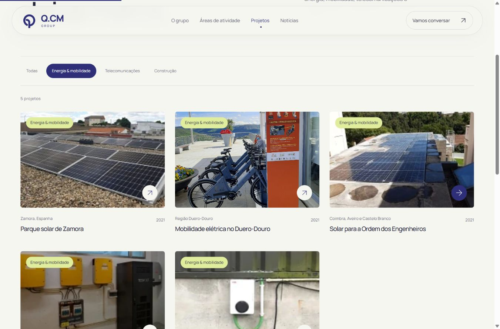

# Q.CM — Horizonte

Site institucional da Q.CM, com uma apresentação editorial contemporânea, a identidade azul original e cores de apoio nas seis áreas de atividade.



## Incluído

- 46 páginas estáticas: grupo, seis áreas, nove projetos, 23 publicações históricas, contactos, informação e 404.
- Pesquisa sem exigir acentos, filtros por área e ano e projetos filtráveis.
- Fotografias a preencher os cartões e Google Maps incorporado com a morada da empresa.
- Menu móvel acessível, animações progressivas e preferência de movimento reduzido.
- HTML legível sem JavaScript, fontes locais, imagens WebP, metadados e mapa do site.

## Executar

Requer Node.js 22 ou superior. Sem dependências de aplicação para instalar.

```sh
npm run dev
```

Abrir http://127.0.0.1:8772/.

```sh
npm test
npm run build
npm run check
npm start
```

A pasta `dist/` é gerada para alojamento estático. As páginas usam endereços a partir da raiz do domínio. Para outro domínio, ajustar `site.origin` em `src/data/site.mjs` antes da geração.

## Organização

- `src/data/`: conteúdos, contactos e configuração editorial.
- `src/render/`: modelos e documentos HTML.
- `src/styles/`: identidade visual, composições responsivas e movimento.
- `src/app.mjs` e `src/filters.mjs`: navegação, pesquisa e preferências.
- `public/assets/`: imagens, símbolo e fontes.
- `scripts/`: geração, verificação e pré-visualização.
- `tests/`: 21 testes de comportamento, conteúdo e publicação.
- `docs/asset-provenance.json`: proveniência das imagens.

## Conteúdos e imagens

O arquivo preserva as datas entre 2018 e 2022. Os projetos usam dados documentados da empresa. A imagem principal é conceptual e está identificada como ilustrativa; as fotografias dos casos provêm do arquivo publicado pela Q.CM. Os contactos são diretos por e-mail, telefone e mapa.

O símbolo Q.CM, as marcas e as fotografias pertencem aos respetivos titulares. A licença da fonte Manrope está incluída em `public/assets/Manrope-OFL.txt`.
